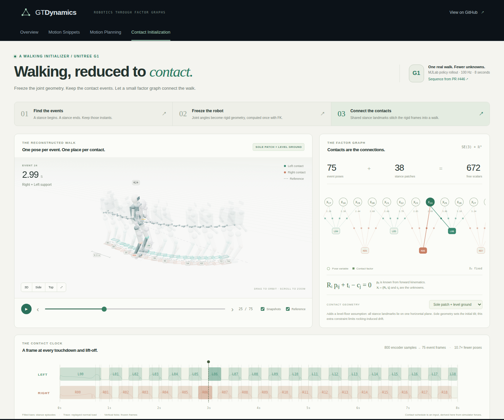

# Contact Initialization

An interactive experiment with a small walking initializer: freeze the robot's
joint geometry at contact events, then connect those rigid snapshots through
stationary stance landmarks. The app uses the actual Unitree G1 policy recording
from [G1 PR #446](https://github.com/borglab/GTDynamics/pull/446).

The default adds an explicit **known level-ground assumption**. Switch to the
rigid-patch-only model to inspect the original contact-only idea, or to a single
point per foot to see its rotational ambiguity. The real G1 walk rocks its feet;
this experiment exposes the resulting drift rather than claiming exact recovery.



## Run

From the repository root, with Node.js 22 or newer:

```bash
cd apps
npm ci
npm run dev --workspace contact-initialization
```

Open <http://127.0.0.1:3003/>. The app includes its 1.58 MB derived recording and
needs no model download, native optimizer, Python server, or GPU to run.

For the shared app navigation, run `npm run dev` from `apps` and open
<http://127.0.0.1:3000/>. See the [workspace instructions](../README.md) for the
other apps' model assets and the combined Pages build.

```bash
# From apps:
npm test --workspace contact-initialization
npm run build --workspace contact-initialization
```

The browser regression checks all three models, event playback, stage selection,
solver history, reference overlays, camera controls, JSON export, direct URLs,
and mobile layout at both `/` and `/GTDynamics/`:

```bash
# From apps, after npm run build; use an existing Playwright installation:
PLAYWRIGHT_MODULE=/absolute/path/to/playwright/index.mjs \
  node contact-initialization/tests/app.browser.mjs
```

The standalone build is `apps/contact-initialization/dist/`. All runtime URLs
are relative, and the solver runs in the browser.

## State and factors

The inputs are measured joint angles, the robot's kinematic model, and a contact
schedule. For event frame `i`, forward kinematics maps a fixed material point
`a_k` on a foot into pelvis coordinates:

```text
p_i,s,k = pelvis_T_foot(q_i) a_k
```

Every stance episode `s` gets a fresh landmark group, even when the same foot
touches down again. All event frames that fall in that stance observe the same
world landmarks. The only unknowns are the root poses `X_i = (R_i,t_i)` and
landmark positions `c_s,k`:

```text
minimize  sum_(i,s,k) || R_i p_i,s,k + t_i - c_s,k ||²
```

The joint angles and each event's body geometry remain constants. There are no
velocity, acceleration, torque, inertial, dynamics, or trajectory-prior factors.
The first pose anchors the coordinate system. Disconnected support components
get independent anchors; no invented motion factor joins them.

Initialization traverses the connected pose/contact graph. Known world landmarks
register the next frozen frame, which then places newly encountered landmarks.
Optimization alternates exact rigid registration of each free pose with centroid
updates of each shared landmark. Pose registration uses Horn's quaternion
solution. The objective is nonconvex; a finite iteration budget is not a proof
of reaching its global minimum.

## Three contact models

| Model | Landmark variables per stance | Added assumption |
| --- | --- | --- |
| Three sole points + level ground, the default | Three landmark xy positions; every z equals a common plane height | All stances lie on one level plane, and a foot is approximately rigid and stationary within its stance |
| Three sole points, contact only | Three independent 3D landmark positions | No sliding or rocking of the rigid sole patch within a stance |
| One sole point | One 3D landmark position | One material foot point remains stationary; full attitude is generally ambiguous |

The three patch landmarks are noncollinear fixed points on a rectangle derived
from the G1 collision sole's lower envelope, expressed in ankle-roll coordinates.
They are not changing collision centroids. Given fixed world landmarks, one point
gives pose rank 3, two distinct points rank 5, and three noncollinear points rank 6.
These local ranks do not replace a global graph observability analysis. In
particular, point mode remains underconstrained after anchoring its first pose;
a low residual cannot identify a unique walking trajectory.

Level-ground mode adds the hard constraint `c_s,k.z = h` to the same objective.
It derives the first anchor's tilt by rotating the first FK sole normal to +z,
keeps that anchor's translation at zero, and sets `h` to the mean height of its
transformed sole points. Thus `h` is a coordinate choice consistent with the
first local foot geometry, not a recorded root height. Landmark updates project
their centroids onto that plane. This mode uses no reference pose or IMU reading,
but the known plane normal and common terrain height are additional physical
assumptions. Horizontal and yaw drift remain possible.

For this recording, there are 75 event poses and 38 stance groups. Point mode
has 149 3D observation factors and 558 free scalar unknowns after anchoring.
Patch mode has 447 3D observation factors and 786 free scalars. The plane reduces
the patch model to 672 free scalars. All three have zero joint-angle variables.

## The recording and event convention

The source is the 8-second, 100 Hz pretrained MJLab G1 walking rollout in PR #446,
at source revision `dba5c5eaea5d9bd19f0fa91191bbbbc9a4291941`. It has 29 actuated
joints and 30 robot bodies. The command is 0.5 m/s; startup domain randomization,
observation noise, and random pushes were disabled by the original recorder,
using seed 42. This is a policy rollout in MJLab, not a GTDynamics walking rollout.

The policy is pinned to
[robomotic/mjlab-policies, revision f277ca8](https://huggingface.co/robomotic/mjlab-policies/tree/f277ca8/g1_velocity/2026-04-26_20-11-37).
The original checkpoint SHA-256 is
`b45a629ce3b6c279201be60362408cb0586fac077e577964bd66a50c32fd4763`.

Support labels come from native MuJoCo replay of the recorded `qpos`, `qvel`, and
`ctrl`. Normal forces are summed over foot/terrain contacts. Hysteresis turns
support on at 20 N and off below 10 N; bounded one-sample force dropouts are
bridged. This joins 15 isolated 10 ms dropouts. The unfiltered force traces remain
available in the app. **Encoders alone do not generally reveal ground contact**;
this demonstration supplies a simulator-derived schedule as an input.

All 800 saved samples are retained. There are 38 stance episodes, 19 per foot,
328 double-support samples, and 471 single-support samples. Sample 0 has no
detected support and is excluded from the graph; otherwise it would be an
isolated pose. The graph spans source samples 1 through 799 and is connected.

Support states use the half-open index interval `[start,endExclusive)`. Each
stance's graph endpoints are `start` and `end = endExclusive - 1`, the last
supported sample. The union of these endpoints contains 75 event frames and
149 pose/stance incidences. A frame that observes two feet is included in both
stances. Contact boundary times have 10 ms sample resolution; they are not
continuous-time impact estimates. The final left stance is clipped by the end
of the recording.

The original recorder saves after each policy step. App timestamps are rebased
so the first saved sample has `t=0`; the first graph event is consequently
`t=0.01 s`, and the last is `t=7.99 s`. The recording contains 8 seconds of
policy steps, while its first-to-last saved timestamp span is 7.99 seconds.

## Reference, accuracy, and limitations

Local FK explicitly replaces the recorded free joint with the identity before
running kinematics. The graph consumes only this local geometry and the contact
schedule. Recorded world root poses are stored separately under `reference` for
the optional overlay and error metrics. They never enter graph construction,
initialization, ground-plane estimation, or optimization. Evaluation aligns the
recorded first event to the graph's anchored first pose, with no trajectory-wide
best-fit alignment.

Independent reconstruction of exported local body points with their held-out
root poses agrees with the MuJoCo world bodies within 0.88 micrometers across
all 24,000 body samples. Every
exported contact observation belongs to its stance interval, and each start/end
has an event frame. This checks the data contract, not the rigid-contact model.

The held-out motion shows why that model is approximate: median stance endpoint
ankle translation is 2.78 cm, with a maximum of 6.46 cm; median rotation is 10.97°,
with a maximum of 30.38°. The foot can rock, roll, slide, and deform its compliant
contacts while still carrying load. Freezing a full sole patch throughout such a
stance introduces errors that accumulate through the chain.

For the checked-in sequence, deterministic initialization followed by at most
100 block iterations gives the following results. Point mode stops after 63
iterations under the objective tolerance. These are approximation results for
one sequence, not a speed or general robot accuracy benchmark.

| Model | 3D contact RMS | Root position RMSE | Root attitude RMSE |
| --- | --- | --- | --- |
| Patch + level ground | 12.12 mm | 0.540 m | 27.70° |
| Contact-only patch | 14.18 mm | 2.197 m | 115.14° |
| One point, an ambiguous displayed solution | 1.89 mm | 0.285 m | 7.57° |

Contact RMS is `sqrt(sum squared 3D residual norms / observation count)`, not
the RMS per scalar coordinate. The small point residual accompanies unresolved
rotations. The patch-only reconstruction can tumble as stance rocking propagates;
the ground assumption improves it while substantial drift remains visible.
Different perturbations or iteration budgets can change the displayed result.
The app reports measured browser solve time separately from export, loading,
rendering, and graph construction; it does not claim a validated speedup.

Flight, lost support overlap, or missing measurements disconnect the contact
chain. Point contacts, slippery ground, uneven terrain, and feet without rigid
soles require different contact assumptions or added information. A practical
initializer could add gravity/IMU measurements, less restrictive contact models,
robust losses, or subsequent full-state optimization; these are not silently
included in the contact-only modes here.

## Reproduce the exported data

The derived JSON is checked in. Regeneration needs the original `model.mjb` and
`walk.npz` from the G1 recording, plus its optional `walk.json` metadata. The
original recorder and policy download instructions are linked from the source
PR; binary recordings and model meshes are not distributed with this app.

The exporter needs NumPy and MuJoCo, with no MJLab import or GPU. The checked-in
export used NumPy 2.5.1 and MuJoCo 3.16.0. Use the matching MuJoCo version to read
the original binary model:

```bash
# In a suitable Python environment, from the repository root:
python -m pip install numpy==2.5.1 mujoco==3.16.0
python apps/contact-initialization/scripts/export_g1_contacts.py \
  --data /path/to/original/g1-recording

# With original recorder metadata stored elsewhere:
python apps/contact-initialization/scripts/export_g1_contacts.py \
  --data /path/to/original/g1-recording \
  --metadata /path/to/original/walk.json
```

The default data directory is `examples/g1_mjlab/results`; the default output is
`apps/contact-initialization/public/g1-walk.json`. Thresholds, bridge length, and
sample period are explicit exporter arguments. Re-exporting the original files
with default settings reproduces the JSON byte for byte.

| Original input | SHA-256 |
| --- | --- |
| `walk.npz` | `dc88c90ba80e09e141ca98480ec49750d0d93f47bc81a38f1911ca1b1b5fb294` |
| `model.mjb` | `64753c4a16f2558daa140b24210467dcfbc732ba3c738e0af79a258e73bdc40d` |

The JSON includes source links and hashes, raw normal-load traces, detector
settings, contact intervals, root-relative body/foot geometry, event membership,
and separate reference/stance-rigidity diagnostics. MJLab attribution and its
Apache 2.0 license are bundled in
[THIRD_PARTY_LICENSES.txt](public/THIRD_PARTY_LICENSES.txt). The original policy
weights and robot mesh files are not part of this app.
