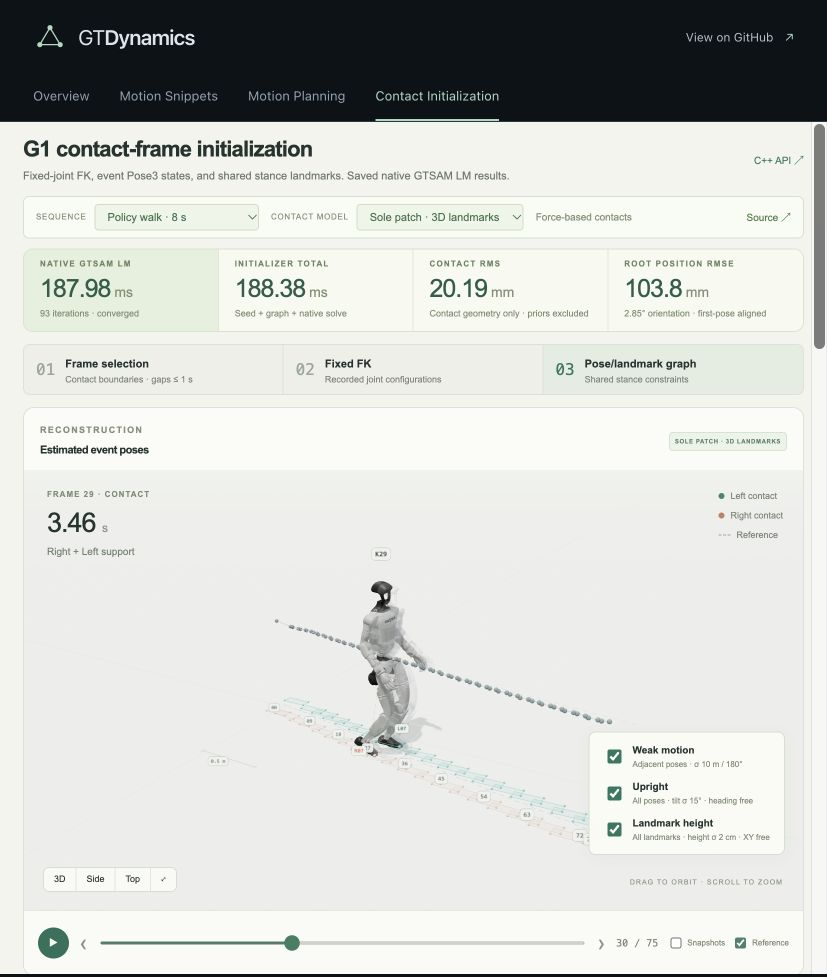

# Contact Initialization

A reusable **C++ GTSAM alternative to inverse-kinematics initialization**,
illustrated with Unitree G1 motion. Measured joint geometry is frozen at contact
boundaries and supplemental samples so frame gaps are at most one second.
GTSAM estimates only the selected root poses and shared stance landmarks.

The browser loads recorded native iterations and timings. It performs no graph
initialization or optimization. Both the 8-second policy walk from [PR #446](https://github.com/borglab/GTDynamics/pull/446)
and a downloaded 30-second [G1 Moves step-touch capture](https://huggingface.co/datasets/exptech/g1-moves)
are selectable. The latter is retargeted human motion, with explicitly heuristic
contact labels and two contact components separated by a short hop.



## Run the app

With Node.js 22 or newer, from the repository root:

```bash
cd apps
npm ci
npm run models
npm run dev --workspace contact-initialization
```

Open <http://127.0.0.1:3003/>. For the shared app site, run `npm run dev` from
`apps` and open <http://127.0.0.1:3000/>. The model bootstrap downloads the pinned
MuJoCo Menagerie assets; the build includes them in the static site. Playback
requires WebGL, but no native server or Python process. All production asset
URLs are relative.

The viewer uses `mujoco-js` and the detailed 29-joint Unitree G1 model from the
same pinned Menagerie checkout as Motion Snippets. It shares the compiled-model
mesh renderer with Motion Planning. Measured joint angles drive MuJoCo forward
kinematics; recorded GTSAM event poses place the robot, snapshots, and reference
overlay. The browser replays these configurations without advancing physics.
Contact footprints and solver recordings retain their original geometry.

The [G1 visual model](https://github.com/google-deepmind/mujoco_menagerie/tree/a03e87bf13502b0b48ebbf2808928fd96ebf9cf3/unitree_g1)
is distributed under Unitree's BSD-3-Clause license, included at
`assets/unitree_g1/LICENSE`. Large model assets remain outside Git.

## Reusable initialization API

The GTSAM-only core is
[`gtdynamics/utils/ContactInitializer.h`](../../gtdynamics/utils/ContactInitializer.h).
It accepts `ContactMeasurements` containing the existing `Slice` context,
the sample timestamp, and frozen FK observations with persistent stance IDs.
`slice.k` preserves the original sample index; selected measurements need not
be consecutive. The core returns poses,
landmarks, `gtsam::Values`, diagnostics, and phase timings, and supports caller
anchors and key conventions. Its implementation has no JSON or reference-data
dependency.

The GTDynamics adapter is:

```cpp
gtsam::Values seeds = initializer.InitializeSolutionContacts(
    robot, rootLinkName, initialRootCOMPose,
    measuredJoints, trajectory, dt, options, &diagnostics);
```

It matches the robot/root/initial-pose arguments and `Values` return type of
`InitializeSolutionInverseKinematics`. The measured joints and a `Trajectory`
of contact phases are the additional inputs. The adapter derives landmark continuity
from each specification's `contactPoints()`, using link identity and fixed
COM-frame points. It includes non-ground contacts; height objectives separately
use `groundContactPoints()` and the contacts' `isGround` flags.
A new contact after an absence gets a fresh landmark; no episode schedule or
touchdown IDs are required. Supported phase boundaries and supplemental frames
feed the sparse solve, then root interpolation and FK expand every trajectory
slice. Unsupported prefix/suffix poses are held constant; internal flight is
interpolated. Measured joint angles and velocities are preserved, using normal
GTDynamics `PoseKey(link_id, sample)` keys.

An estimator that accepts a root pose seed can consume those poses while keeping
its own IMU twists, velocities, and bias initialization. The C++ adapter rejects
disconnected schedules rather than silently joining unrelated gauges. This is
a compatible pose-seeding workflow, not a literal replacement for IK's desired
pose inputs. The same API is exposed in the standard `gtdynamics` Python package.

See [the integration example and API contract](docs/initializer-api.md).

## Factor graph and native solve

For a fixed sole point `a_j`, FK at event `i` supplies a fixed measurement
`p_ij = root_T_foot(q_i) a_j`. Each touchdown creates a fresh stance landmark
set; all events within that stance share it. The objective is

```text
minimize sum_(i,j) || R_i p_ij + t_i - c_j ||²
```

Joint angles and individual link poses are not optimization variables. The
first pose of each connected component is held constant by excluding its key
from the optimized state; its contact factors become unary landmark factors.
The default adds no motion or attitude prior. Optional factors are described below; IMU and reference factors are never added.

The initializer first traverses the contact graph, registering frames against
already placed contacts using a small rigid SVD fit. For 3D patches it also
tries a traversal using the centroid of each patch's contact points, retaining the
seed with lower contact cost on the full patch observations. This avoids
accumulating foot-rocking tilt in the seed without adding height or attitude
constraints. If the set of contact points changes between frames, it skips the
centroid candidate. Then
`gtsam::LevenbergMarquardtOptimizer` jointly updates all free event `Pose3` and
contact variables, with analytic Jacobians and multifrontal Cholesky. Numerical
LM diagonal damping permits point-mode solves but adds no measured attitude
information. The recorded cap is 100 LM iterations; stopping tolerances are
relative objective improvement `1e-8` or absolute improvement `1e-12`.

The app offers two contact models, both with free `Point3` landmark heights:

| Mode | Contact variables | Assumption |
| --- | --- | --- |
| Contact-only sole patch | Three `Point3` landmarks per stance | Stationary rigid sole, with no terrain constraint |
| One contact point | One `Point3` per stance | Point support; rotations remain ambiguous |

Landmark heights are constrained only when the height-prior checkbox is enabled.
The native API and recording archive also retain the hard-floor `Model::Ground`
experiment, but the app does not expose it. Given fixed world landmarks, one point provides pose rank 3, two distinct points rank
5, and three noncollinear points rank 6. Local ranks do not certify global graph
observability or physical validity of the no-slip assumption.

G1 rocks its feet about 11 degrees per stance on median in the original rollout.
That model mismatch accumulates through contact-only rigid soles. A small
contact residual is not a guarantee of trajectory accuracy.

## Explore optional factors

The contact selector and checkboxes inside the animation window select all
eight saved combinations of weak motion, upright, and landmark-height priors
for each of the two contact models, for both sequences (32 selectable native
configurations). Every solve, timing measurement,
and held-out error calculation runs in C++; the browser selects saved results.
Large timing and error cards appear above the viewer. The comparison table
appears below the animation.

`Options::addBetweenFactors` adds an identity `BetweenFactor<Pose3>` between
consecutive event poses. Its diagonal covariance is
`diag(pi², pi², pi², 100, 100, 100)` in GTSAM's rotation-radian/translation-metre
tangent order: standard deviations are 180 degrees and 10 metres. These weak
motion assumptions connect separate contact components, and only the first
pose then remains fixed. No relative motion is taken from the reference.

`Options::addUprightFactors` adds the residual `R_i * Z - Z` on every pose,
with a 15-degree small-angle standard deviation. It constrains tilt while
leaving heading and translation free, and also penalizes upside-down poses.
Fixed gauge poses retain their constant upright cost.

`Options::addGroundFactors` adds one scalar residual `c_j.z - h` for each
unique `Point3` landmark, with `groundSigma = 0.02` metres. The factor leaves
XY unconstrained and does not reparameterize landmarks or project their seeds.
By default, `h` is the mean height of the first stance's points transformed by
the fixed first pose. The caller can instead supply `groundPriorHeight` in
world coordinates. Reference poses never determine this height. Without this
factor, landmark Z coordinates remain optimization variables with no floor
constraint.

All optional priors are off by default in the C++ API. The app initially selects
3D sole landmarks and automatically selects the prior combination with the
lowest saved translation RMSE among configurations matching the current
height-prior checkbox when the sequence or contact model changes. Height starts
off and changes only through an explicit checkbox or table-row selection.
Manual checkbox changes still select any saved combination. All three standard
deviations can be set through the native API.

Contact RMS always uses contact residuals alone. The recorded weighted objective
separately reports contact, between, upright, and ground-height costs. Reference pose errors
are evaluated after solving, outside the timed scopes. Each independent graph
component has one reference alignment; enabling weak motion changes this to
one global alignment. The table labels this distinction for the longer clip.

## Native timings and accuracy

The checked-in measurements were regenerated on **October 31, 2026**, using
**Intel Core i7-14700F, Linux x86_64, Ubuntu Clang 18.1.3, Release, GTSAM 4.3.2**,
one Eigen thread, and `MULTIFRONTAL_CHOLESKY`. Each model has 2 warmups and
11 fresh runs. The app reports medians, minima, p95, all raw samples, iteration
counts, build details, and exact source/data hashes. The p95 is the empirical
nearest-rank quantile; with 11 repetitions it is the maximum sample.

| Sequence / mode | Native LM median | Initializer total median | LM iterations | 3D contact RMS |
| --- | ---: | ---: | ---: | ---: |
| 8 s policy / contact-only patch | 266.78 ms | 267.32 ms | 100, cap reached | 10.85 mm |
| 8 s policy / one point | 5.29 ms | 5.42 ms | 7 | 1.89 mm |
| 30 s capture / contact-only patch | 65.44 ms | 65.82 ms | 68 | 17.67 mm |
| 30 s capture / one point | 5.84 ms | 5.93 ms | 10 | 15.34 mm |

The table above shows the configurations without optional priors. All eight combinations
are saved in the recording files and compared in the UI. The archive includes
24 configurations per sequence (three contact models × eight prior combinations);
the UI exposes the patch and point models.

The longer capture has fewer selected frames (55 versus 75), different motion and
contact evidence, and disconnected components; its shorter solve time is not a
duration-scaling benchmark. These measurements do not establish a speedup over
an IK initializer.

The core timer separates rigid registration seed, graph construction, and LM.
Optimization includes LM construction, linearization, damping, and sparse solves.
Repeated timing runs disable history capture; a separate run records snapshots.
FK extraction, dataset adaptation, reference evaluation, dense adapter expansion,
file IO, JSON, network, and rendering are excluded. Total time covers the sparse
initializer, not an end-to-end estimator initialization. Individual phase
medians need not sum exactly to the total median.

The 8-second contact-only patch result has root position RMSE 1.168 m and
orientation RMSE 85.45 degrees, after aligning only the first event, and reaches
the iteration cap. With only the height prior enabled, patch RMSE is 0.229 m /
13.48 degrees; with motion and height it is 0.195 m / 8.11 degrees. The point-mode displayed
solution gives 0.285 m / 7.58 degrees, but its attitude remains underconstrained.
Recorded root poses are supplied separately for post-solve C++ evaluation and
display. They never enter the initializer or its optimization graph.

For the 30-second capture, each support component is aligned independently at
its first event. The contact-only patch component-relative RMSE is 0.316 m / 17.84 degrees;
this is not accuracy of one globally recovered 30-second trajectory. No factor
or rendered trajectory line connects the independent components in contacts-only
mode. Enabling weak motion explicitly connects them using a prior.

## Build C++ and reproduce recordings

The benchmark builds on its own with GTSAM and Boost 1.75 or newer:

```bash
cmake -S apps/contact-initialization/backend -B /tmp/contact-init-build \
  -DCMAKE_BUILD_TYPE=Release -DGTSAM_DIR=/path/to/lib/cmake/GTSAM
cmake --build /tmp/contact-init-build -j2
ctest --test-dir /tmp/contact-init-build --output-on-failure
python3 apps/contact-initialization/scripts/export_native_recordings.py \
  --optimizer /tmp/contact-init-build/contact_initializer
```

On hosts with multiple CUDA installations, an installed GTSAM may require
`-DCUDAToolkit_ROOT=/matching/cuda/path` for its transitive dependencies. The
initializer and measured solves use the CPU.

Alternatively enable `GTDYNAMICS_BUILD_CONTACT_INITIALIZATION_WEBDEMO=ON` in a
normal GTDynamics build. The core and adapter are always included in the
GTDynamics library; this option adds the benchmark executable and app tests.
`testContactTrajectoryInitializer` exercises the installed-library API's COM
frames, original sample keys, measured joints/velocities, dense expansion,
input checks, and disconnected-schedule rejection.

The native executable reads one JSON request from stdin or an input filename.
It writes graph metadata, actual LM iterations, benchmark statistics, and build
details. The Python exporter only orchestrates native runs and packages them;
it does not solve the graph or evaluate pose errors. It strips reference and
metadata from the solver dataset, supplies a separate `evaluationReference`
field used only after solving, and records exact C++ source, binary, and dataset
SHA-256 hashes. The baseline runs are in `models`; the seven additional factor
combinations per contact model are in `variants`.

Dataset generation, pinned downloads, contact thresholds, attribution, and
licenses are documented in [DATA.md](DATA.md). The longer capture's height/speed
heuristic does not create force measurements or establish no-slip contact.

## App verification

```bash
cd apps
npm test
npm run build
PLAYWRIGHT_MODULE=/absolute/path/to/playwright/index.mjs \
  node contact-initialization/tests/app.browser.mjs
```

The app tests verify that MuJoCo visual FK matches the recorded body frames in
both sequences, including reordered joint names. They independently recompute
recorded residuals, verify native source
and data hashes, anchors, hard floor constraints, history, and timing statistics.
Browser regression covers both sequences, all modes and prior combinations,
replay, top-level timing/error display,
JSON export, camera/overlays, mobile layout, and `/GTDynamics/` asset URLs.
