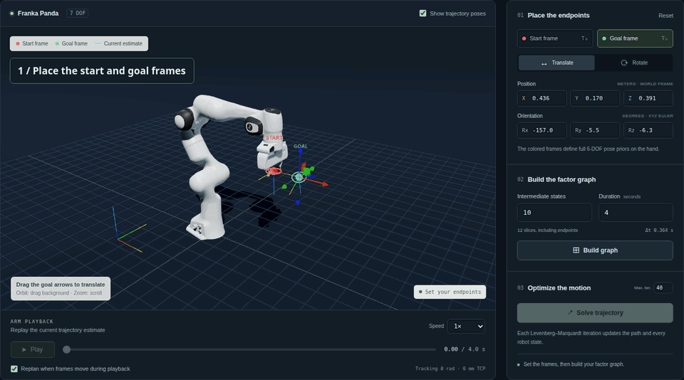

# Franka motion planning demo

A local teaching app alongside `webdemo`: drag two six-DOF tool frames, build a
GTDynamics kinematic factor graph, watch native GTSAM iterations reshape the
trajectory, and replay the current estimate with MuJoCo in your browser.



The short demo shows a goal edit, a graph with 12 kinematic states, the recorded
optimizer iterations, and arm playback followed by a live goal update.

The C++ process owns the graph and optimization. The browser uses MuJoCo WASM
and Three.js for simulation and rendering; it does not substitute a JavaScript
IK solver. Each browser connection has its own native process and graph.

Read the standalone [architecture guide](public/architecture.html) for diagrams,
the complete graph formulation, message flows, and playback details. With the
app running, open `/architecture.html` or use **Architecture & equations** in
the app footer.

## Setup

Use the same C++ dependencies as GTDynamics, plus **Boost 1.75+** (Boost.JSON),
**Node.js 18+**, npm, Python 3, and Git. From the repository root, configure your
normal GTDynamics build with the optional demo target:

```bash
cmake -S . -B build -DGTDYNAMICS_BUILD_MOTION_PLANNING_WEBDEMO=ON
cmake --build build --target motion_planning_optimizer motion_planning_factor_test -j2
python3 motion-planning-webdemo/scripts/bootstrap_models.py
cd motion-planning-webdemo
npm install
npm run dev
```

Open **http://127.0.0.1:3001**. The original demo uses port 3000. The new app
starts Vite on 3001 and the local WebSocket bridge on 8766 together; Ctrl-C
stops both. The first visit loads the Panda meshes and MuJoCo WebAssembly.

If CMake needs help locating dependencies, add your existing
`-DCMAKE_PREFIX_PATH=...`. This demo does not require the Python bindings. A
fresh C++-only build can use `-DGTDYNAMICS_BUILD_PYTHON=OFF` and
`-DGTDYNAMICS_BUILD_EXAMPLES=OFF`. To use another build directory:

```bash
MOTION_PLANNING_BACKEND=/absolute/path/to/motion_planning_optimizer npm run dev
```

The servers bind to loopback. When running on a remote development machine,
forward port 3001 to your laptop, for example `ssh -L 3001:127.0.0.1:3001 HOST`,
and open the same local URL. The WebSocket travels through Vite, so port 8766
does not need to be forwarded.

## Demonstrating the two animations

1. Select the **red start** or **green goal** frame. Use the translation arrows
   or rotation rings, or edit its position and orientation numerically.
2. Choose the number of intermediate states and total duration, then click
   **Build graph**. This constructs the slices and their temporal factors;
   it does not run the optimizer.
3. Click **Solve**. Each snapshot comes from an actual native GTSAM LM
   iteration. The path, small tool frames, and ghost link skeletons show how
   the whole trajectory estimate changes. Inspect or replay those snapshots
   with the iteration history controls.
4. Click **Play** to move the solid Franka along the selected trajectory.
   This is a separate clock from the solver history. MuJoCo integrates the
   robot using its position actuators, with gravity compensation. The demo
   interpolates the optimized joint positions and velocities using cubic
   Hermite segments. Desired-velocity feedforward compensates the actuators'
   damping, including when reversing or changing playback speed. At each end,
   the trajectory clock waits while physics continues until the actual tool
   reaches its frame within 0.1 mm and 0.001 rad, with low joint velocity for
   100 ms, then reverses. If it cannot settle within two simulation seconds,
   playback pauses and displays the remaining error.
5. With live replanning enabled, edit either target while the arm plays.
   Endpoint priors are replaced, optimization restarts from the current
   estimate, and playback follows the arriving trajectory. Rapid edits are
   coalesced; stale solver replies cannot overwrite the newest targets.

Changing the number of states or duration requires a new graph. A difficult
or unreachable target can leave a residual even when the optimizer stops;
inspect the endpoint errors rather than equating convergence with success.

## What is in the graph?

At each time index, the variables are the seven joint angles `q`, seven joint
velocities `qdot`, eight link COM poses `T ∈ SE(3)`, and eight body twists `V`.
GTDynamics' `Kinematics::qFactors(Slice, robot)` and
`Kinematics::vFactors(Slice, robot)` enforce pose and twist kinematics with a
fixed base. Joint-limit costs and endpoint pose priors complete the spatial
problem. A tool-frame goal is converted to the corresponding link COM goal;
it is not treated as a COM position directly.
Endpoint pose priors use sigma `1e-5` in the six-dimensional Pose3 tangent
(radians for rotation, meters for translation), ten times tighter than the
initial demo. This is a soft-cost scale, not a hard bound on physical tracking.
The native solver reports success only when the endpoint errors computed from
joint-angle forward kinematics are below 0.1 mm and 0.001 rad. The playback
readout independently measures the simulated arm's tracking error.

The existing `Kinematics::graph(Interval, robot)` collects slice graphs; it
does **not** add temporal factors automatically. This app adds, between
adjacent slices with fixed `dt = duration / (states - 1)`:

```text
q[k+1] - q[k] - dt/2 * (qdot[k] + qdot[k+1]) ≈ 0
Log(T[k+1]⁻¹ * T[k] * Exp(dt/2 * (V[k] + V[k+1]))) ≈ 0
```

The pose equation follows GTDynamics' body-twist trapezoidal collocation
convention. The demo supplies the full Logmap Jacobian chain rule in a local
subclass of the existing factor. It also penalizes changes in joint velocity
and imposes near-zero endpoint velocities. Integration provides temporal
consistency; the velocity-change cost is what favors smooth motion.

All factors are weighted soft costs. Ghost skeletons display optimized link
poses, while the simulated arm follows optimized joint angles. Their temporary
disagreement during optimization is meaningful. Neither the optimizer nor its
interpolated trajectory includes collision-avoidance costs in this demo.

This is a **motion planning demo** using batch LM warm starts. Moving an endpoint
changes the planning problem. MuJoCo's feedback controller tracks the resulting
trajectory, but its execution measurements never enter the factor graph.

## What would it take to implement full STEAP?

[STEAP (Simultaneous Trajectory Estimation and Planning)](https://arxiv.org/abs/1807.10425)
jointly estimates the executed trajectory and plans its future continuation,
conditioned on incoming sensor measurements and planning costs. Repeatedly
solving for new endpoint targets does not provide that joint estimation.
Extending this demo would require:

1. **A trajectory spanning past, present, and future.** Track execution time and
   retain the executed states as estimation variables alongside the unexecuted
   plan. Replace the current ping-pong replay clock with an execution cursor.
2. **Measurement factors with timestamps and uncertainty.** Initially stream
   actual MuJoCo `qpos`/`qvel` observations, optionally with simulated noise, back
   to C++. Associate measurements with the correct states (or interpolate for
   asynchronous observations), and give them explicit noise models. Desired
   actuator commands are not measurements.
3. **A probabilistic temporal model.** For a formulation matching the paper, use
   a continuous-time Gaussian-process trajectory prior and its corresponding
   interpolation, with process noise and state uncertainty. The repository's
   `GPLinearPriorFactor` is a starting point; retain the kinematic constraints
   needed to relate joint states to link poses and twists. The current
   trapezoidal and velocity-change costs alone do not implement that model.
4. **Persistent joint inference as observations arrive.** Add measurement factors
   and update both the past estimate and future plan. iSAM2 offers incremental
   updates; track factor indices so planning priors can be replaced or removed
   as execution progresses. Merely swapping LM for iSAM2, or resetting the start
   pose from a sensor reading, does not implement the joint problem.
5. **An execution and replanning loop.** Execute the future portion from the
   current estimated state, ingest observations, update the joint solution,
   and send revised future commands. Keep recorded execution separate from
   desired motion; at arrival, use an observation rather than treating the goal
   as evidence of where the arm actually ended. To reproduce the paper's
   collision-aware planning, also add obstacle/SDF factors and collision checks
   between support states; obstacle avoidance is currently absent.
6. **A demonstration of estimation under disturbances.** Show measured,
   estimated, and planned motion separately, including uncertainty. Test noisy
   or delayed observations and execution disturbances, verifying that new data
   changes the estimated history and remaining plan, and that updates meet the
   execution loop's timing requirements.

The existing [STEAP tests](../gtdynamics/gpmp2/tests/testSTEAP.cpp) provide a small
starting example: a GP trajectory prior, obstacle factors, iSAM2 measurement
updates, and replacement of a goal prior with an arrival measurement. Connecting
those ideas to this app's simulated execution is the missing integration.

## Model coordinates and assets

The optimizer loads `models/urdfs/panda/panda.urdf`. The browser loads
`franka_emika_panda` from MuJoCo Menagerie at pinned revision
`a03e87bf13502b0b48ebbf2808928fd96ebf9cf3`. The bootstrap script downloads only
that model into an ignored, app-local cache, links it into `public/assets`,
and writes an asset manifest. It leaves the original demo's model setup alone.
Model attribution and license remain in the downloaded model directory.

Both sides use a right-handed Z-up world, meters, radians, and JSON
quaternions ordered `[x, y, z, w]`. The tool frame is Menagerie's hand frame
translated 0.1034 m along local Z (from link7: translation `[0,0,0.2104]`
and rotation `Rz(-π/4)`). The two finger joints are held open and are not
optimization variables.

## Verification and implementation

```bash
# From the repository root:
ctest --test-dir build -R '^motion_planning_' --output-on-failure
cd motion-planning-webdemo
npm test
npm run build
```

The C++ tests check collocation Jacobians and native graph convergence,
retargeting, and input validation. The Node tests exercise solver streaming,
rapid edits, cancellation across the process boundary, and the interpolated
velocity used by the playback controller. The optional real-browser regression
in `tests/playback.browser.mjs` checks physical endpoint arrivals, speeds,
retargeting continuity, and timeout recovery. It requires a running dev server,
Chrome, and a separate Playwright installation:

```bash
PLAYWRIGHT_MODULE=/absolute/path/to/playwright/index.mjs \
  node tests/playback.browser.mjs
```

- `backend/`: native graph, LM stepping, NDJSON protocol, and tests.
- `server/`: local WebSocket-to-NDJSON bridge; one C++ process per tab.
- `src/viewer.js`: MuJoCo loading, frame gizmos, trajectory ghosts, and playback.
- `src/App.vue`: teaching controls, live replanning, and iteration history.

Browser commands are `build`, `solve`, `stop`, and `targets`. The bridge sends
native `describe`, `build`, `targets`, and single-step `iterate` commands with
request IDs. Snapshots contain graph counts, costs, endpoint errors, and all
trajectory states. stdout is reserved for JSON; native diagnostics use stderr.

The visualizer follows the same MuJoCo/Three.js approach as the adjacent
`webdemo`, whose framework lineage is
[Axellwppr/humanoid-policy-viewer](https://github.com/Axellwppr/humanoid-policy-viewer).
Runtime dependencies are MuJoCo (`mujoco-js`), Three.js, Vue, Vite, and `ws`.
